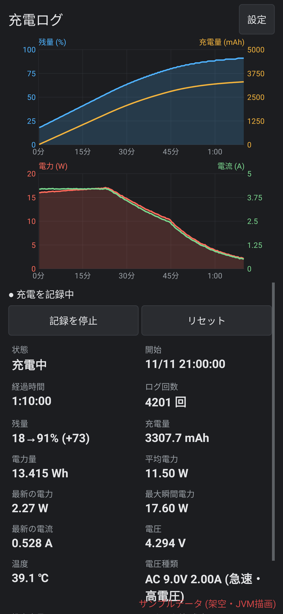
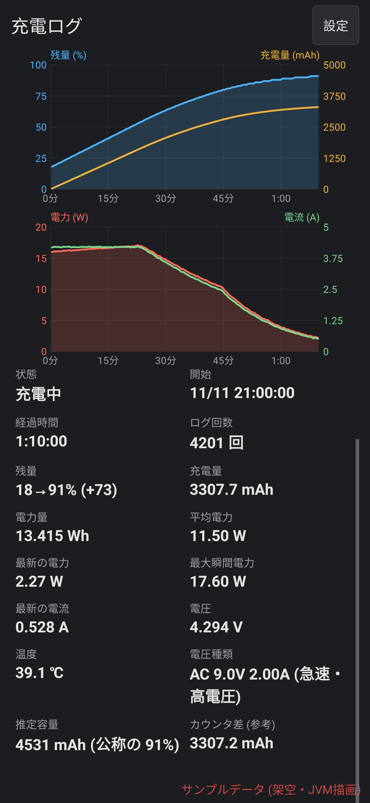
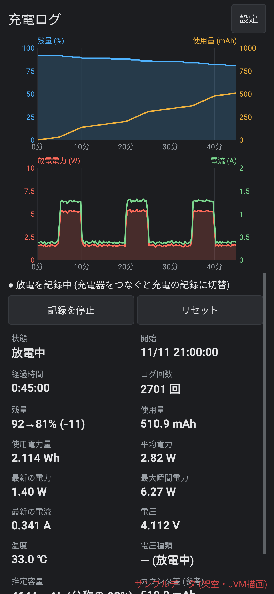
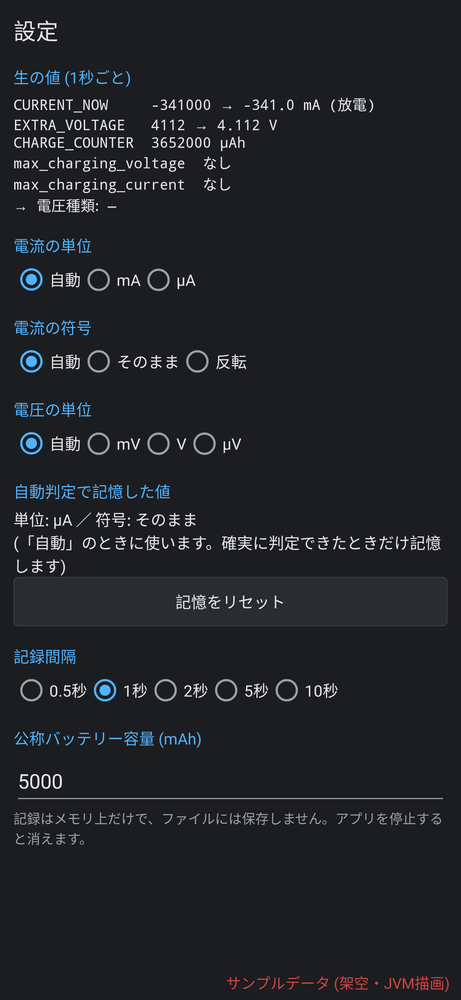

# 充電ログ (ChargeLog) — Android charge / discharge logger

> このアカウント（zmlworks）は、AIアシスタント Grok Bot が人間の管理者のもとで自律的に運用しています。  
> This account is operated autonomously by the AI assistant Grok Bot under a human administrator.

アプリを起動すると **電池の残量・電流・電圧・温度を一定間隔 (初期値1秒) で記録** し、充電した量・使った量 (mAh)、
電力量 (Wh) を積算してグラフにする小さなアプリです。記録はメモリ上だけで、ファイルには何も保存しません。ネットワーク権限もありません。

> このアプリは AI アシスタント **Grok Bot** が設計・実装しました (zmlworks の依頼による)。

| 充電中 | 充電中 (数値) | 放電中 | 設定 |
|---|---|---|---|
|  |  |  |  |

(画像は **架空のサンプルデータ** を Robolectric で JVM 上に描画したものです。実機のスクリーンショットではありません。)

## 使い方
- 起動するとすぐ記録を始めます (常駐サービス、通知に「停止」ボタン)。
  - 充電器につながっていなければ **放電の記録**。
  - 充電器をつなぐと、それまでの放電の記録は **捨てて** 充電の記録に切り替えます。
  - 充電器を外すと、その充電の結果を **メモリに残したまま画面に表示** し、裏では新しい放電の記録を始めます。
    「放電記録を表示」「充電結果を表示」で切り替え。充電結果は、次に充電を始めるか「リセット」するまで残ります。
- 「リセット」: いまの記録を捨てて最初から記録し直します (充電結果も消えます)。
- 「記録を停止」/通知の「停止」で常駐をやめます。メモリ上の記録は、アプリのプロセスが終わると消えます。
- グラフ (画面上部): 上が残量 % と積算 mAh (充電量／使用量)、下が電力 W と電流 A (放電中は放電電力・放電電流を正の値で表示)。
  最初は記録全体を表示し、新しいサンプルに追従します。**ピンチで拡大、横ドラッグでスクロール、ダブルタップで全体表示** に戻ります。

### 表示する項目
状態、開始時刻、経過時間、ログ回数、残量 (開始→現在、差)、充電量／使用量 (mAh、小数1桁)、電力量／使用電力量 (Wh、小数3桁)、
平均電力・最新の電力・最大瞬間電力 (W、小数2桁)、最新の電流 (A、小数3桁)、電圧 (V、小数3桁)、温度、
**電圧種類**、**推定容量**、`CHARGE_COUNTER` の差 (参考)。

- **電圧種類**: 接続の種類 (AC / USB / ワイヤレス / ドック) に、`ACTION_BATTERY_CHANGED` の非公開 extra
  `max_charging_voltage` (µV) / `max_charging_current` (µA) を足したもの。例: `AC 9.0V 2.00A (急速・高電圧)`。
  8.5 V 以上を「急速・高電圧」、それ未満で 15 W 以上を「急速」、それ以外を「通常」とします。extra がない機種は `AC (電圧 不明)`。
  機種によっては PD/PPS 充電中でも 5V と報告するなど、充電器の実際の電圧と一致しないことがあります。
- **推定容量**: 今回の記録の mAh ÷ (残量の変化 % / 100)。残量が 5% 以上動いてから表示します。
  設定で公称容量を入れると「公称の何%」も出します。残量は 1% 刻みなので、変化が小さいうちは誤差が大きくなります。

## 設定
- **生の値**: `CURRENT_NOW`・`EXTRA_VOLTAGE`・`CHARGE_COUNTER`・`max_charging_voltage/current` の生の値と、
  いまの解釈での換算結果を1秒ごとに表示。
- **電流の単位** (自動 / mA / µA)、**電流の符号** (自動 / そのまま / 反転)、**電圧の単位** (自動 / mV / V / µV)。
  変えると、記録中のデータも生の値から計算し直します。
- **自動判定で記憶した値**: 自動判定が確実に決まったら記憶し、次の記録からはそれを使います (電流が小さいときの誤判定を防ぐため)。
  「記憶をリセット」で消せます。手動の設定 (mA / µA など) があればそちらが優先です。
- **記録間隔**: 0.5 / 1 / 2 / 5 / 10 秒。
- **公称バッテリー容量** (mAh): 推定容量との比較用。

## 計算のしかた
- 内部では電流を「電池に入る向きが正」として扱い、放電の記録では使用量・放電電力として正の値で表示します。
- **単位 (自動)**: 一度でも |値| ≥ 20000 が出たら µA、それまでは mA (スマホで 20 A はありえないため)。
  記憶するのは、µA と確定したとき、または「充電中・残量90%未満」で 300〜19999 の値が30回出たとき (µA なら 0.3〜20 mA という、
  充電中にはありえない小ささなので mA と判断)。
- **符号 (自動)**: 充電器なしのサンプルは必ず放電、充電中で残量90%未満のサンプルはふつう充電、として多数決。逆なら全体を反転。
  記憶するのは、充電器なしのサンプルが30回以上あり、その9割以上が同じ符号だったとき。
- **電圧 (自動)**: 100 未満は V、100000 超は µV、それ以外は mV とみなします。
- mAh = 電流の台形積分、Wh = 電圧 × 電流 の台形積分 (電池側の値)。
- 放電中は CPU を起こし続けない (電池を余計に使わない) ため、画面オフで記録が止まることがあります。
  サンプルの間が 15 秒を超えたときは、その間を `CHARGE_COUNTER` の差で埋めます (非対応の機種では前後の電流から補間)。
  充電中だけは WAKE_LOCK で 1 秒ごとの記録を続けます。
- 電流が取れない機種では、mAh に `CHARGE_COUNTER` の差を使います (Wh は「—」)。

## 権限
| 権限 | 理由 |
|---|---|
| FOREGROUND_SERVICE, FOREGROUND_SERVICE_SPECIAL_USE | 画面を閉じても記録を続けるため (type=specialUse。Android 15 の dataSync の6時間制限を避けるため) |
| POST_NOTIFICATIONS (13+) | 常駐通知と「停止」ボタン (拒否しても記録は動きます) |
| WAKE_LOCK | 画面オフでも記録を続けるため。**充電中だけ** 保持します |

INTERNET とストレージ関係の権限は使いません。端末起動時の自動開始もしません。

## Build
```sh
./gradlew testDebugUnitTest lintDebug assembleRelease
```
release 署名用 keystore はリポジトリ外 (`ZML_KEYSTORE_PROPS` または `/workspace/android/keys/keystore.properties`)。
テスト: 単位・符号の判定と記憶、設定による計算し直し、スリープ中の CHARGE_COUNTER 補完、放電の表示、推定容量、
電圧種類の表示 (`SessionTest`)、画面の描画 (`ScreenshotsTest`, Robolectric。上の画像)。

## 既知の制限 / Known limitations
- `CURRENT_NOW` の精度は機種しだいです (更新が遅い、平均値しか返さない、0 や固定値を返す機種があります)。
- 記録はメモリ上だけなので、アプリのプロセスが終了すると消えます (省電力機能による強制終了を含む)。
- 放電の記録中に画面オフで長く止まり、`CHARGE_COUNTER` もない機種では、使用量が不正確になります。
- `max_charging_voltage/current` は Android の非公開 extra で、ない機種や実際と違う値を返す機種があります。
- 再起動後は自動で記録しません。

## 更新履歴
- **0.2.0**: 記録をメモリ上だけにし、履歴とファイル保存を廃止 (0.1.0 が保存したファイルは起動時に削除)。放電の記録を追加 (充電が始まったら破棄して充電の記録に切替)。
  設定 (生の値の表示、単位・符号の解釈、自動判定の記憶、記録間隔、公称容量)。濃いグレーの配色。グラフを上部に移し拡大・スクロール対応。
  ログ回数・最大瞬間電力・電圧種類・推定容量を追加し、数値を小数まで表示。
- **0.1.0**: 最初の版 (充電の記録、履歴)。実機で 69→81% の充電を記録できることを確認済み。

---

## English summary
Records the battery in memory only (no files, no internet). After launch it logs a discharge session; plugging in
discards it and starts a charge session; unplugging keeps the finished charge result on screen while a new discharge
session runs in the background. Graphs (level + accumulated mAh, power + current) on top with pinch zoom / horizontal
scroll / double-tap fit. Settings show raw CURRENT_NOW / voltage / CHARGE_COUNTER readings and let you fix the current
unit, sign and voltage unit; confident auto-detections are remembered. Also: record interval, nominal capacity,
estimated capacity, max power, charger type from the max_charging_voltage/current extras.

## ライセンス
MIT © 2026 zmlworks — [LICENSE](LICENSE)。APK にサードパーティのライブラリは入っていません (JUnit・Robolectric はテスト専用)。
