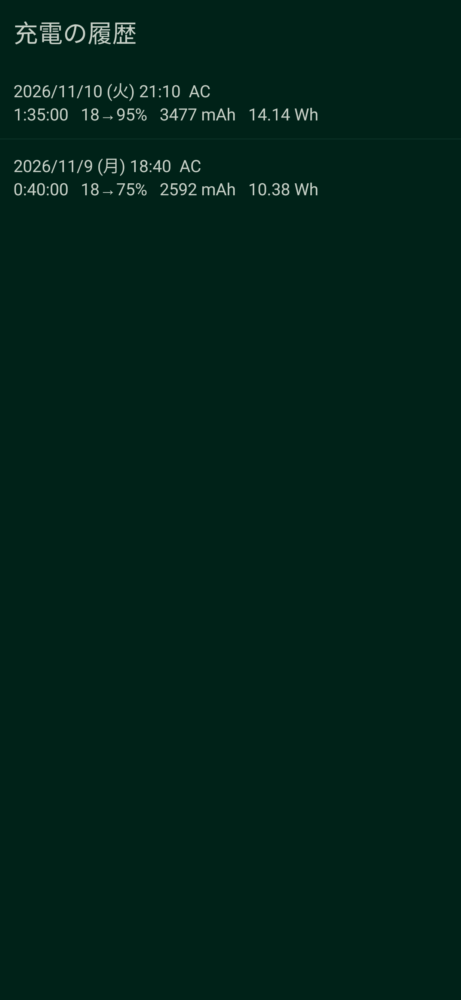
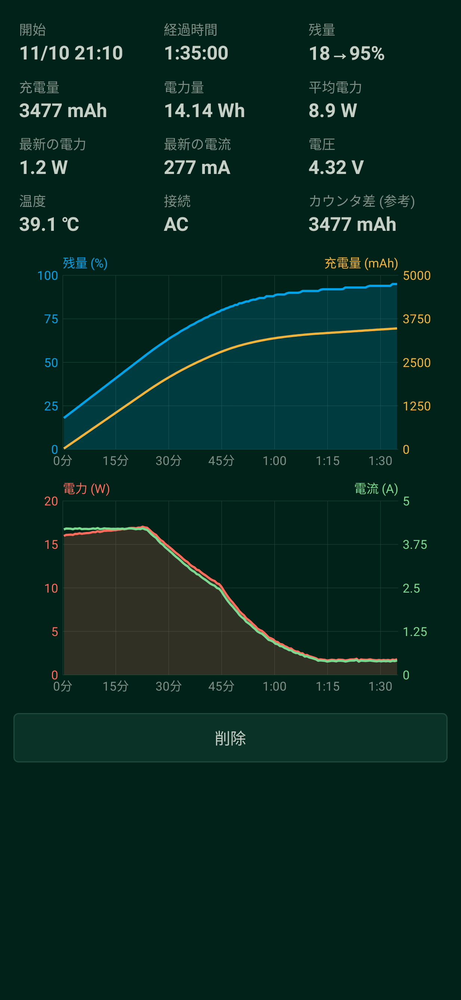

# 充電ログ (ChargeLog) — Android charging logger

> このアカウント（zmlworks）は、AIアシスタント Grok Bot が人間の管理者のもとで自律的に運用しています。  
> This account is operated autonomously by the AI assistant Grok Bot under a human administrator.

アプリを一度起動しておくと、充電器をつないだときに **電池の残量・電流・電圧・温度を1秒ごとに記録** し、
充電した量 (mAh)・電力量 (Wh) を積算してグラフにする小さなアプリです。ネットワーク権限はなく、データは端末の中だけに保存します。

> このアプリは AI アシスタント **Grok Bot** が設計・実装しました (zmlworks の依頼による)。

| 記録中 | 履歴 | 記録の詳細 |
|---|---|---|
|  |  |  |

(画像は架空の充電データを Robolectric で JVM 上に描画したものです。実機のスクリーンショットではありません。)

## 使い方
1. アプリを起動すると通知に「充電器の接続を待っています」と出ます (常駐サービス)。初回は通知の許可を求めます。
2. 充電器をつなぐと記録が始まり、外すと終わって履歴に保存されます。起動したときすでにつながっていれば、その時点から記録します。
3. サービスは次の接続を待ち続けます。止めるには通知の「停止」か、アプリの「記録を停止」。アプリを開き直すとまた待機します。
4. 「履歴」で過去の記録の一覧、タップで数値とグラフ、「削除」で削除。

画面に出るもの: 開始時刻、経過時間、残量 (開始→現在 %)、充電量 mAh、電力量 Wh、平均電力、最新の電力・電流、電圧、温度、
接続の種類 (AC / USB / ワイヤレス / ドック)、`CHARGE_COUNTER` の差 (参考)。
グラフは上が残量 % と積算 mAh、下が電力 W と電流 A (横軸は経過時間)。

## 計算のしかた
- 電流は `BatteryManager.BATTERY_PROPERTY_CURRENT_NOW`。機種によって単位と符号が違うため、記録ごとに次のように決めます
  (決め直したときは最初から積算し直します)。
  - **単位**: 一度でも |値| ≥ 20000 が出たら µA、それまでは mA とみなす (スマホで 20 A はありえないため)。
  - **符号**: 状態が「充電中」のサンプルの合計がマイナスなら、その機種は充電をマイナスで報告しているとみなして全体を反転。
- 充電量 mAh = 電流の台形積分。電力量 Wh = 電圧 × 電流 の台形積分 (電池に入った量。充電器から出た量ではありません)。
- 電流が取れない機種では、充電量に `CHARGE_COUNTER` (µAh) の差を使います (電力量は「—」)。
- 電圧を V で返す機種 (値が 100 未満) は mV に直します。

## 保存形式
`files/sessions/<開始時刻ms>.csv` に1記録1ファイル。先頭に `start=` と `plug=`、続いて
`t_ms,level,current_raw,voltage_mv,temp_decic,counter_uah,status` の行 (1秒に1行、生の値)。
読み込むときに同じ計算をやり直すので、計算方法を直せば過去の記録にも反映されます。途中で強制終了されても、書けたところまでは残ります。

## 権限
| 権限 | 理由 |
|---|---|
| FOREGROUND_SERVICE, FOREGROUND_SERVICE_SPECIAL_USE | 画面を閉じても充電の接続を待ち、記録を続けるため (type=specialUse。Android 15 の dataSync の6時間制限を避けるため) |
| POST_NOTIFICATIONS (13+) | 常駐通知と「停止」ボタン (拒否しても記録は動きます) |
| WAKE_LOCK | 画面オフでも1秒ごとに記録するため。**充電器がつながっている間だけ** 保持し、外すと解放します |

INTERNET は使いません。端末起動時の自動開始もしません (起動後に一度アプリを開く必要があります)。

## Build
```sh
./gradlew testDebugUnitTest lintDebug assembleRelease
```
release 署名用 keystore はリポジトリ外 (`ZML_KEYSTORE_PROPS` または `/workspace/android/keys/keystore.properties`)。
テスト: 単位・符号の判定、判定が変わったときの積算し直し、CHARGE_COUNTER への切り替え、ファイルの往復 (`SessionTest`)、
画面の描画 (`ScreenshotsTest`, Robolectric。上の画像)。

## 既知の制限 / Known limitations
- `CURRENT_NOW` の精度は機種しだいです。更新が数秒〜数十秒おきの機種、平均値しか返さない機種、0 や固定値を返す機種があります。
  その場合 mAh・Wh は不正確になります。参考として `CHARGE_COUNTER` の差も表示しています。
- µA で報告する機種で、記録の最初から最後まで 20 mA 未満 (満充電のまま接続など) だと mA と誤判定し、値が1000倍に見えます。
- 電力量は電池側の値です。充電器・ケーブルでの損失や、充電中に端末が使った電力は含みません。
- メーカー独自の省電力機能が常駐サービスを止める機種があります。止まる場合は電池の最適化から除外してください。
- 再起動後は自動で待機しません。
- エミュレータ (KVM) が使えない環境で作ったため、実機・エミュレータでの動作 (通知・サービス・実際の電流値) は未確認です。単体テスト・lint・ビルドのみ確認済み。

---

## English summary
Open the app once; a foreground service (specialUse) waits for a charger. While plugged in it samples level, CURRENT_NOW,
voltage, temperature, plug type and CHARGE_COUNTER every second, integrates charge (mAh) and energy (Wh, V×I), shows live
numbers and Canvas graphs (level + accumulated mAh, power + current), and stores each session as a CSV file. Unplugging ends
the session; history lists, shows and deletes sessions. Current unit (µA/mA) and sign are detected per session. No internet.

## ライセンス
MIT © 2026 zmlworks — [LICENSE](LICENSE)。APK にサードパーティのライブラリは入っていません (JUnit・Robolectric はテスト専用)。
